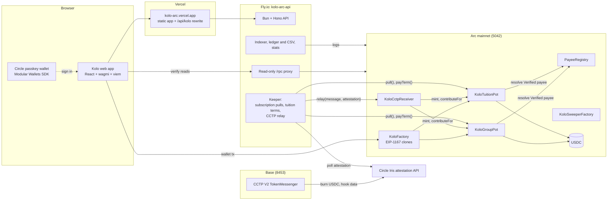

# Kolo

**Group money that can only go where it was promised.** Kolo is a purpose-locked USDC pot on Arc. A group of people pool money for a school term, a wedding, a trip or a team gift. The payee is sealed in when the pot is created. Money leaves the pot only to that payee, only against an invoice the co-signers approved, and every payment has a receipt anyone can check against the chain. If the deadline passes without a payout, contributors claim their money back pro rata.

Built for Arc Microgrants 2. Live on **Arc mainnet (chain 5042)**.

| | |
|---|---|
| App | https://kolo-arc.vercel.app |
| API | https://kolo-arc-api.fly.dev/api/kolo (also reachable at https://kolo-arc.vercel.app/api/kolo) |
| Arc Studio | https://studio.arc.io/app/c4df9a2d-d7b1-4471-98f6-10549fb2a886 |
| Explorer | https://explorer.arc.io |
| Source | https://github.com/AshThunder/kolo |

---

## The problem

In Nigeria and much of Africa, money for shared goals moves through WhatsApp groups and one person's bank account. School fees are paid in terms, often by several relatives and sponsors. Celebrations, burials, trips and community projects are funded the same way.

That arrangement fails in predictable ways:

- **No proof.** Contributors have a screenshot of a transfer, not a record of where the money went.
- **Too much trust in one person.** The organiser holds the cash and decides alone what to pay.
- **Wrong payee.** A school or vendor account number gets swapped, mistyped or spoofed.
- **No clean refund.** If the event is cancelled, returning money to twelve people is manual and awkward.
- **Value erodes.** Naira balances held for weeks lose purchasing power. USDC does not.

## What Kolo does

1. **Seal.** The organiser picks a template (group pot or school tuition), the payee, the amount and the deadline. The payee is fixed on-chain at creation. For a school, it must be a **Verified** entry in the on-chain PayeeRegistry.
2. **Fill.** Anyone contributes USDC from Arc, or from Base through CCTP. Each contribution gets a receipt number and a public verify page.
3. **Release or refund.** The organiser uploads an invoice. Co-signers approve it. The pot pays the sealed payee. If the deadline passes without a payout, everyone claims a pro-rata refund. A tuition pot pays the school term by term on due dates.

Two pot types share one factory:

- **GroupPot**: up to 5 payees, up to 10 co-signers (the organiser counts as a signer), milestones with caps, invoices, approvals, disputes, pledges and recurring contributions.
- **TuitionPot**: pays one verified school on a term schedule, with a statement per paid term.

---

## Live on mainnet

Everything below is on Arc mainnet and can be opened today. Amounts are small on purpose: the demo pots hold cents of real USDC.

### Demo pots

| # | Pot | State | Public page | Receipt to verify |
|---|---|---|---|---|
| 1 | Kemi and Tunde's Housewarming (GroupPot) | Completed: 0.25 USDC in, 0.10 released to the vendor, 0.15 refunded to 3 contributors | [/p/1](https://kolo-arc.vercel.app/p/1) | [Released 0.10](https://kolo-arc.vercel.app/verify/r/5042/0xaeb9ee67c9f598b3c57042727a927386641d3c3afa9ab0a08cc575698177b2f5/23) · [Refunded 0.06](https://kolo-arc.vercel.app/verify/r/5042/0x2d46740a511578935469e186fa9f25cc51b26490898e5e00e464bea47eec96cf/3) |
| 2 | Adaeze's Owambe (GroupPot) | Active: 0.27 locked, one recurring pull, invoice of 0.12 with 1 of 2 approvals | [/p/2](https://kolo-arc.vercel.app/p/2) | [Recurring pull 0.05](https://kolo-arc.vercel.app/verify/r/5042/0x8b644183e06d33bf443ce0cb913ad3238c5955dbdc3077d193086576626ea677/34) · [Co-signer page](https://kolo-arc.vercel.app/cosign/2/1) |
| 3 | Chinedu's JSS3 Tuition, Term 1 (TuitionPot) | Term 1 (0.05) paid to the school; term 2 due 6 Nov 2026; 0.07 still locked | [/p/3](https://kolo-arc.vercel.app/p/3) | [Term 1 paid](https://kolo-arc.vercel.app/verify/r/5042/0xf79fd375591874225d3c9b6aebc2fa1d5075b221aa24c94f59998be63087f4c5/3) |

Pot contracts: #1 [`0xd982…2c41`](https://explorer.arc.io/address/0xd982F90037Ca4eB95528Bb231274ab6bDE5c2c41) · #2 [`0xd6AC…e3f9`](https://explorer.arc.io/address/0xd6ACC04B7F96De3380cC67D87511e4171bb6e3f9) · #3 [`0x1C88…17C`](https://explorer.arc.io/address/0x1C889afcf002EDC57aA57bfEC22e91fa3D0B717C)

Global totals at the time of writing, from `GET /api/kolo/stats`: 3 pots, 0.34 USDC locked, 0.15 released, 0.15 refunded, 3 contributors, 8 contributions. The home page shows the same numbers live.

Other pages worth opening: [Payee directory](https://kolo-arc.vercel.app/payees) · [How it works](https://kolo-arc.vercel.app/how-it-works) · [Create a pot](https://kolo-arc.vercel.app/create) · [Pay link for pot 2](https://kolo-arc.vercel.app/pay/2)

### Example mainnet transactions moving USDC

| What | Transaction |
|---|---|
| Pot 1 released 0.10 USDC to the vendor | [`0xaeb9ee67…77b2f5`](https://explorer.arc.io/tx/0xaeb9ee67c9f598b3c57042727a927386641d3c3afa9ab0a08cc575698177b2f5) |
| Pot 3 paid term 1 (0.05 USDC) to the school | [`0xf79fd375…87f4c5`](https://explorer.arc.io/tx/0xf79fd375591874225d3c9b6aebc2fa1d5075b221aa24c94f59998be63087f4c5) |
| Pot 1 created | [`0x44134805…370f5a`](https://explorer.arc.io/tx/0x441348059390ca854c845dce5118ed14175c0e52d7e6d4333430180e2d370f5a) |
| Pot 2 created | [`0x7c20470c…6022c6`](https://explorer.arc.io/tx/0x7c20470cb593f1e54a5ed4e721b8ae612511a04426c9141d910cf3505c6022c6) |
| Pot 3 created | [`0x73c67dce…8353c2`](https://explorer.arc.io/tx/0x73c67dce10a195c94e3bbd328e5a0a95f42d8548e9fcb911f449fc66b28353c2) |
| Recurring pull of 0.05 USDC into pot 2 | [`0x8b644183…6ea677`](https://explorer.arc.io/tx/0x8b644183e06d33bf443ce0cb913ad3238c5955dbdc3077d193086576626ea677) |
| Refund of 0.06 USDC from pot 1 | [`0x2d46740a…ec96cf`](https://explorer.arc.io/tx/0x2d46740a511578935469e186fa9f25cc51b26490898e5e00e464bea47eec96cf) |

### Contracts (Arc mainnet, chain 5042)

| Contract | Address | Deploy tx |
|---|---|---|
| PayeeRegistry | [`0xd90008F52a37cA35b92Aa7bF39BF853cE2ff8F20`](https://explorer.arc.io/address/0xd90008F52a37cA35b92Aa7bF39BF853cE2ff8F20) | [`0x8c4d7636…8081a`](https://explorer.arc.io/tx/0x8c4d76369b62ae43179ffacf732136a2faf9773a48011d7a3d742ab583b8081a) |
| KoloGroupPot (implementation) | [`0x460C09572f4cE0FeF37E74A8dAE7C3b7A36A9E0f`](https://explorer.arc.io/address/0x460C09572f4cE0FeF37E74A8dAE7C3b7A36A9E0f) | [`0x4a4e0716…b69c40`](https://explorer.arc.io/tx/0x4a4e0716e861b1c21d5622ffe76da4c44a09eddc5bdb9745f6afd61252b69c40) |
| KoloTuitionPot (implementation) | [`0x597Cd6181046B25895dBe6D4ba9143136eAe8C50`](https://explorer.arc.io/address/0x597Cd6181046B25895dBe6D4ba9143136eAe8C50) | [`0x7ec5bb23…3686de`](https://explorer.arc.io/tx/0x7ec5bb23154d16cd8c0546886d4fe25e9deb268aa8a215dbebdd533b253686de) |
| KoloFactory | [`0xf9ab7f396d00955CB96Ef48fd98fA72f44bc262d`](https://explorer.arc.io/address/0xf9ab7f396d00955CB96Ef48fd98fA72f44bc262d) | [`0xf4ace1b6…72edfa`](https://explorer.arc.io/tx/0xf4ace1b6c947190040a5dddee063a4a88c2dec398411e69fbed870f80672edfa) |
| KoloCctpReceiver | [`0x6b937828cE1005Dac2C459A253a46b1152236021`](https://explorer.arc.io/address/0x6b937828cE1005Dac2C459A253a46b1152236021) | [`0x493d9b5b…a265b7`](https://explorer.arc.io/tx/0x493d9b5baade8c9b95a7af4b91545b253a74c8e6f4bcd9289e23e0d2eda265b7) |
| KoloSweeperFactory | [`0xfa1ac8b10cAdD65Bf6d839e9C4CE825f2d9e6FFb`](https://explorer.arc.io/address/0xfa1ac8b10cAdD65Bf6d839e9C4CE825f2d9e6FFb) | [`0x10d38f59…a384afa`](https://explorer.arc.io/tx/0x10d38f592dca0684af63594780a6241605b5a9cb512272ef919f981a0a384afa) |
| USDC (Arc ERC-20 interface, 6 decimals) | [`0x3600000000000000000000000000000000000000`](https://explorer.arc.io/address/0x3600000000000000000000000000000000000000) | system contract |

Roles: owner, fee treasury and registrar are `0x6449986070E1Ae8A1619BEd166d960843DaBcB2b`. The keeper (a separate hot wallet that runs scheduled pulls, term payments and CCTP relays) is `0x757c8708A2FE522B48fBBd5DF7BC63b29748aCc6`. The factory fee is 0 bps and capped at 100 bps in code.

Deployed 23 Oct 2026 by one script, 12 transactions, 0.2093 USDC in gas in total. The registry and both pot implementations are byte-identical to the local Foundry build. The factory, receiver and sweeper differ only by constructor immutables.

**Demo payees in the registry**

| # | Name | Kind | Wallet | Status |
|---|---|---|---|---|
| 1 | Kolo Demo Academy | School | `0xA764e0133Bc228ac40FCd5D3314fFB1b8bAe1B6e` | Verified |
| 2 | Kolo Demo Venue | Vendor | `0x925E63f23fC94F46f15De453A6c12A20BdDCfF3C` | Registered, not yet verified |

Pots 1 and 2 pay the vendor wallet as a fixed direct address. The pot page says so. Pot 3 resolves the school through the registry.

---

## Features

**Trust and proof**
- **Verifiable receipts.** Every contribution, release, refund and term payment has a receipt ID (for example `KOLO-R-aeb9ee-23`). The verify page re-reads Arc from your browser and checks the transaction, the decoded event, that the pot was created by the Kolo factory, and that the USDC went to the pot's named payee. Nothing relies on the Kolo server. Receipts export as PNG with a QR code.
- **Public pot pages.** `/p/:id` is read-only and needs no wallet: who contributed, how much, what was paid out, with a link to the explorer.
- **Payee proof and registry.** Schools, vendors and hospitals are registered on-chain with a hashed name and document hash, then verified by a registrar. Only Verified payees can be chosen for a registry-backed pot. Revoking a payee freezes every pot that points at it. Applicants can apply at `/payees/apply`; after applying they get a reference ID (for example `KOLO-APP-2`) and a link to message the admin on Telegram ([@chrisgolde](https://t.me/chrisgolde)) for faster verification.
- **Tuition statements.** Each paid term has a downloadable statement.
- **CSV export.** The full ledger of a pot downloads as CSV.

**Collecting money**
- **Pay links and QR.** Each pot has a short link and QR code (`/pay/:id`, `/p/:id`) so a contributor can pay from a phone in a chat thread.
- **Pledged vs paid.** Contributors can pledge an amount with a due date. The pot shows pledged and paid separately.
- **Recurring contributions.** A contributor subscribes to an amount, interval and number of pulls. The keeper pulls on schedule. Pot 2 has a live example.
- **Pay in from Base.** USDC on Base burns through CCTP V2 and mints on Arc straight into the pot, tagged with the contributor and memo.
- **Circle passkey wallet.** Sign in with a passkey, no seed phrase. See the limitations below.

**Spending money**
- **Milestones.** A group pot can carry up to 20 milestones, each with a cap. Invoices reference a milestone.
- **Invoices with co-signer approvals.** The organiser attaches an invoice hash. The configured number of co-signers must approve before release. Approvals can also be gasless through EIP-712 signatures.
- **Disputes.** A co-signer can flag an invoice. Signers vote to uphold or cancel it. Each signer votes once, and flags have a cooldown.
- **Tuition terms.** The school is paid per term on due dates by the keeper. Leftovers are refunded pro rata.

**Everyday use**
- **Templates.** The create wizard starts from a template: Group gift, Trip, Medical bill (pays a hospital, never a person), Term tuition, Community project.
- **Local-currency estimates.** Amounts show an estimated value in NGN and other currencies. This is display only. Everything on-chain is in USDC.
- **Live on-chain stats.** Totals on the home page come from the indexer and fall back to direct chain reads.
- **Account menu.** Shows the signed-in account, with a confirmed log out that clears wallet, passkey and local state.

---

## Architecture



**Contracts** (`contracts/kolo/`, Solidity 0.8.28, Foundry)
- `PayeeRegistry`: payees, statuses (Unregistered, Registered, Verified, Revoked), kinds (School, Vendor, Hospital), registrar role, 48-hour wallet-change delay.
- `KoloFactory`: deploys pot clones, sets canonical USDC, factory and pot ID inside each clone, indexes pots. Ownable2Step.
- `KoloGroupPot`, `KoloTuitionPot`: the pot logic. Clones share one implementation.
- `KoloCctpReceiver`: receives a CCTP V2 message and attestation, mints USDC, and credits the pot through `contributeFor`. The receiver verifies the attestation on-chain, so the relayer is not trusted.
- `KoloSweeperFactory`: deterministic deposit addresses that sweep into a pot.

**Server** (`server/`, Bun + Hono). Indexer, ledger and CSV, stats, FX proxy, pot title metadata, the keeper, and a read-only RPC proxy with an allow-list. It holds no user funds. It can only call functions that anyone can call.

**Frontend** (`src/`, Vite, React 18, TypeScript, Tailwind). `src/network.ts` is the single source of truth for chain, addresses, CCTP and Circle settings. The default network is mainnet.

---

## How Arc, USDC, CCTP and Circle are used

- **Arc.** Arc's fast finality makes "paid" mean paid within seconds. Gas is paid in USDC, so a contributor or organiser needs one asset. A createPot costs about 0.010 USDC, a typical step 0.001 to 0.005 USDC. Receipts verify against Arc's public RPC and explorer.
- **USDC.** The pot asset. Arc's USDC ERC-20 interface at `0x3600…0000` uses 6 decimals, while native gas uses 18. Kolo only ever uses the 6-decimal interface for amounts. Pots hold no other token.
- **CCTP V2.** TokenMessengerV2 on Base burns USDC with hook data `(pot, contributor, memoHash)`. Circle's Iris API attests the burn. `KoloCctpReceiver.relay` verifies and mints on Arc (domain 26) and credits the pot. Standard finality, `maxFee = 0`. The path was run end to end from Base Sepolia to Arc testnet. See the limitations for mainnet.
- **Circle Modular Wallets.** Passkey sign-in creates a smart account with no seed phrase. The Circle transport on mainnet is `/arc`. Sessions are device-local.
- **Circle Gas Station.** The app is wired for sponsored transactions from the passkey wallet. The mainnet sponsorship policy is not configured yet.

---

## How Arc Studio was used

Project: https://studio.arc.io/app/c4df9a2d-d7b1-4471-98f6-10549fb2a886

Arc Studio wrote the Solidity contracts and their Foundry tests (unit, fuzz and invariant), built the Vite and React app around them, ran logic and security review passes, and deployed the first version to Arc Testnet. The mainnet deployment was run from this same source with a Foundry script (`scripts/deploy-mainnet.sh`), because Studio deploys to testnet only. The bytecode on mainnet matches the local build of the Studio contracts. The server, the keeper and the later UI work (create wizard, registrar console, account menu) were built on top of the Studio project.

---

## Security model

- **Sealed payee.** Pots store the payee at creation. The organiser cannot change it. A registry payee resolves only while its status is Verified.
- **Registrar.** `register`, `verify`, `revoke` and `executeWalletChange` are restricted to `REGISTRAR_ROLE`. Today the registrar is a single address, the deployer. A multisig would be the next step.
- **48-hour payee wallet change.** A payee asks for a new wallet with `requestWalletChange`. The change takes effect only after 48 hours and a registrar's `executeWalletChange`. A swapped address cannot take effect silently.
- **Revocation.** Revoking a payee freezes every pot that points at it. `release()` re-checks the registry, so an invoice approved before a revoke still cannot pay out.
- **Canonical addresses.** The factory overwrites USDC, factory and pot ID in each clone after initialisation, so a creator cannot supply a fake token.
- **Dispute and close approvals.** One vote per signer, tracked by bitmap. Early close needs the co-signer threshold.
- **Allowance hygiene.** The CCTP receiver and sweepers zero any residual allowance after use.
- **Server hardening.** CORS allow-list. A POST from a foreign `Origin` gets 403. Rate limits of 240 GET and 20 POST per minute. 8 KB body cap. The RPC proxy is read-only with a 64 KB cap and 25-call batches. Admin routes use timing-safe bearer checks. The keeper key is separate from the deployer key.
- **Secret hygiene.** Keys exist only in `~/.kolo/*.env` files (mode 600) on the build machine and as Fly secrets (`KEEPER_PRIVATE_KEY`, `KEEPER_RUN_TOKEN`, `KOLO_ADMIN_TOKEN`). The Docker context uses a strict whitelist `.dockerignore`. Every web bundle is scanned for known secret values before upload. The browser holds only a Circle client key, which is public by design. No secret is in this repository.

The contracts went through an internal security review with six high-severity findings, all fixed and covered by tests. See `docs/kolo-security-review.md`. **This is not a third-party audit.** The contracts hold small amounts today and should be audited before they hold real money at scale.

---

## Run it locally

Requirements: [Bun](https://bun.sh) 1.x, [Foundry](https://getfoundry.sh), Node 20+.

```bash
bun install
bun run dev                     # Vite dev server, mainnet by default
```

The web app reads `VITE_CIRCLE_CLIENT_KEY`, `VITE_CIRCLE_CLIENT_URL`, `VITE_KOLO_API` and `VITE_KOLO_RPC`. The Circle client key is public by design. Set it to your own Circle Console key to try passkey sign-in. The web app never needs a private key.

Use testnet instead of mainnet with `VITE_KOLO_NETWORK=testnet bun run dev` (Arc Testnet, chain 5042002).

**API and keeper**

```bash
cp server/env.example server/server.env   # git-ignored; never commit it
# fill in the settings, then:
bun run server:dev                                # API on http://localhost:8787/api/kolo
```

Server settings: `ARC_RPC_URL`, `PORT`, `KOLO_CORS_ORIGINS`, `KOLO_START_BLOCK`, `KEEPER_PRIVATE_KEY`, `KEEPER_RUN_TOKEN`, `KOLO_ADMIN_TOKEN`, `KEEPER_DISABLED`, `CCTP_IRIS_URL`. Without `KEEPER_PRIVATE_KEY` the API runs read-only and `/health` reports `"keeper": "dry-run"`.

**Test**

```bash
forge test                       # 94 contract tests, including fuzz and invariants
bun run server:test              # 40 server tests
bun run check                    # lint and typecheck
```

**Deploy**

```bash
# Contracts: scripted, writes addresses to a deployment JSON.
# Dry run against a local anvil fork of Arc mainnet:
RPC_URL=http://127.0.0.1:8599 DRY_RUN=1 scripts/deploy-mainnet.sh
# Real broadcast needs CONFIRM_MAINNET=yes and spends USDC for gas.

# Web: build with the MAINNET Circle client key, then deploy the prebuilt output to Vercel.
VITE_CIRCLE_CLIENT_KEY="$VITE_CIRCLE_CLIENT_KEY_MAINNET" bun run build

# API: Fly.io. The .dockerignore is a whitelist.
flyctl deploy --depot=false
```

The deploy scripts spend real USDC on mainnet. Read them first.

---

## Test results

| Suite | Result |
|---|---|
| Foundry contract tests (`forge test`) | **94 / 94 pass** (6 suites: registry, group pot, tuition pot, CCTP, accounting invariants) |
| Server tests (`bun test server/src/__tests__`) | **40 / 40 pass** |
| Mainnet dry run (`DRY_RUN=1 scripts/mainnet-smoke.sh`, local fork of Arc mainnet) | **31 / 31 pass**: a 2-of-2 GroupPot flow and a TuitionPot flow, including contributions, a recurring pull, invoice, approvals, release, close and refunds |
| Live mainnet demo | 3 pots created and exercised on mainnet, with receipts that verify in the browser |
| Browser checks (Playwright) | Create wizard, registrar verify flow, log out, and the live pages and receipts all pass with no console errors |

Gas measured during the dry run and the live demo: createPot about 0.010 USDC, typical step 0.001 to 0.005 USDC, full deploy about 0.21 USDC.

---

## Known limitations

We would rather state these than have you find them.

- **Passkey wallet cannot send yet.** A passkey wallet can sign in and show balances. Sending from it needs a Circle Gas Station sponsorship policy for Arc mainnet, which is pending. Until then, transactions go through a connected EVM wallet.
- **Base to Arc CCTP pay-in is untested on mainnet.** The full path was proven from Base Sepolia to Arc testnet, and the mainnet addresses are configured. A mainnet pay-in has not been run. The Solana option in the contribute dialog is disabled and says so.
- **Contract source is not yet verified on the explorer.** Deployed bytecode matches the local build. The Standard-JSON inputs and constructor arguments are prepared, and verification is a manual upload on the explorer's verification page.
- **One registrar, one owner key.** Both are the deployer wallet. A multisig is the right next step.
- **Demo vendor is unverified.** "Kolo Demo Venue" (#2) is registered but not verified, so it cannot be picked for new registry-backed pots. Pots 1 and 2 pay it as a fixed address.
- **Create wizard supports one payee.** The contracts allow up to 5 payees per group pot.
- **Local-currency values are estimates.** They come from a public FX feed (open.er-api.com) and are not a quote.
- **No third-party audit** (see above).
- **Refunds are claimed, not pushed.** After the deadline anyone can move a pot to refunding, and each contributor claims their share.

---

## Screenshots

Captured from the live mainnet deployment, unless noted. Files are in [`screenshots/`](screenshots/).

| File | What it shows |
|---|---|
| [`01-home.png`](screenshots/01-home.png) | Home page with live on-chain totals |
| [`02-create-template.png`](screenshots/02-create-template.png) | Create wizard, step 1: choose a template |
| [`03-create-amounts.png`](screenshots/03-create-amounts.png) | Amount and deadline, live preview, local-currency estimate |
| [`04-create-review.png`](screenshots/04-create-review.png) | Review and seal |
| [`05-create-mobile.png`](screenshots/05-create-mobile.png) | The wizard at 390 px wide |
| [`06-group-pot-public.png`](screenshots/06-group-pot-public.png) | Public page of a GroupPot: sealed payee, contributions, QR, CSV export |
| [`07-tuition-pot-public.png`](screenshots/07-tuition-pot-public.png) | Tuition pot with the term schedule and statement download |
| [`08-contribute.png`](screenshots/08-contribute.png) | Contribute dialog: Arc or Base |
| [`09-receipt-release.png`](screenshots/09-receipt-release.png) | Receipt verification of a release |
| [`10-receipt-refund.png`](screenshots/10-receipt-refund.png) | Receipt verification of a refund |
| [`11-payee-registry.png`](screenshots/11-payee-registry.png) | Public payee directory: verified and awaiting verification |
| [`12-registrar-console.png`](screenshots/12-registrar-console.png) | Registrar console (captured on a local fork of mainnet state) |
| [`13-account-menu.png`](screenshots/13-account-menu.png) | Account menu with the log out confirmation |

---

## Repository layout

```
contracts/kolo/        Solidity contracts
contracts/test/kolo/   Foundry tests
server/                Bun + Hono API, indexer, keeper
src/                   React app (network.ts holds chain and address config)
scripts/               deploy, smoke and QA scripts
docs/                  security review
```

## Team

_To be filled in at submission._

## License

_To be confirmed before the repository is published._

## Video

TODO: walkthrough video link.
